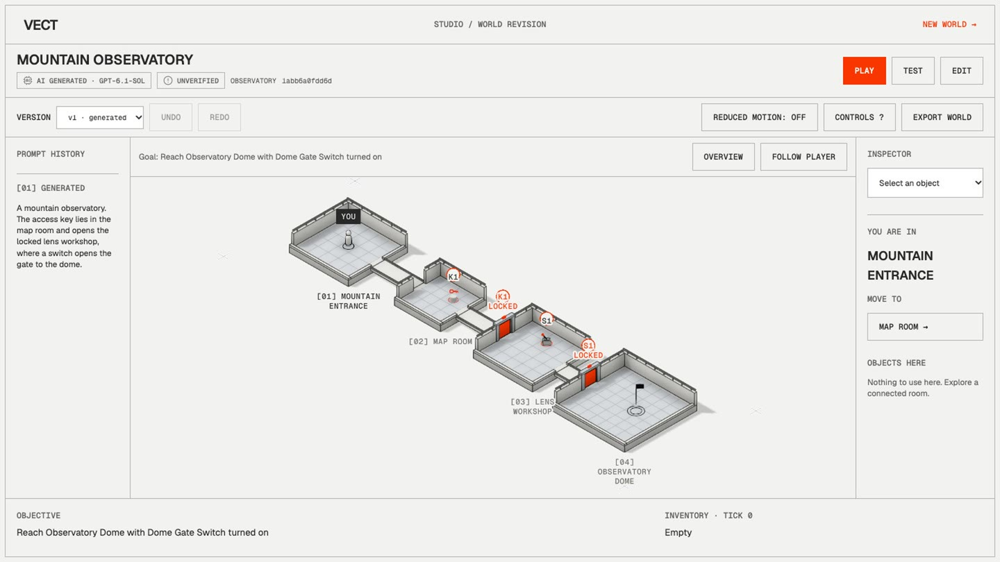
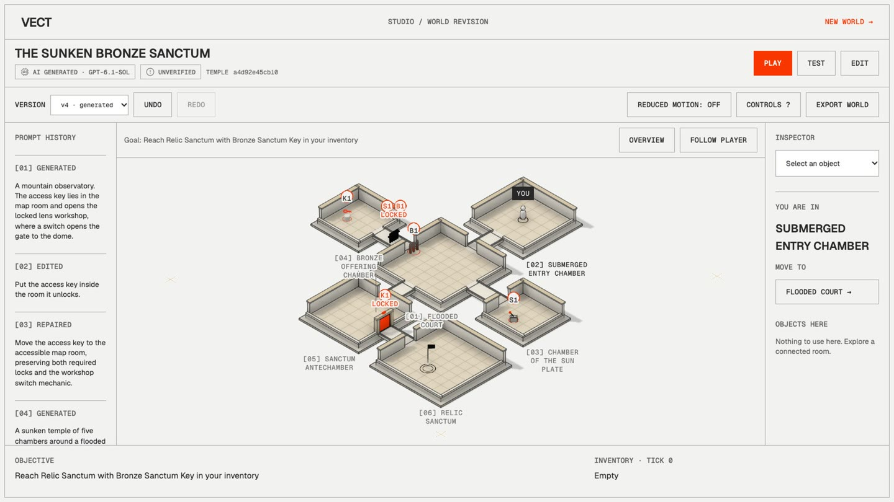
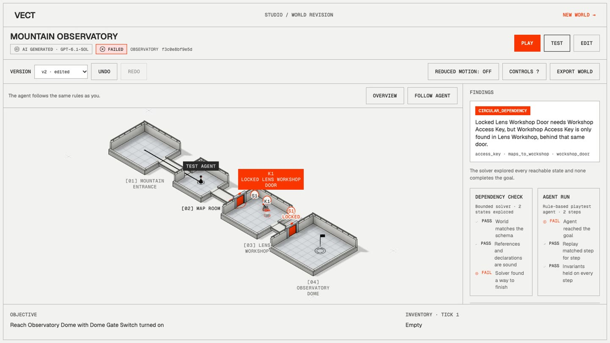
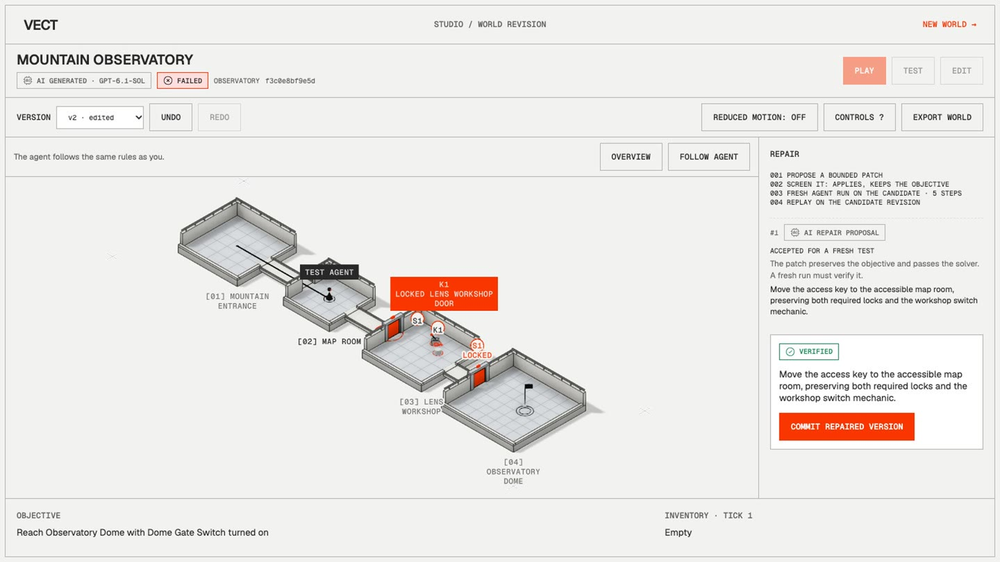
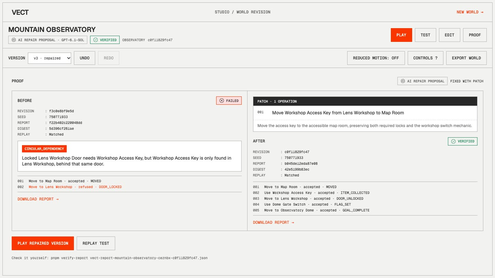
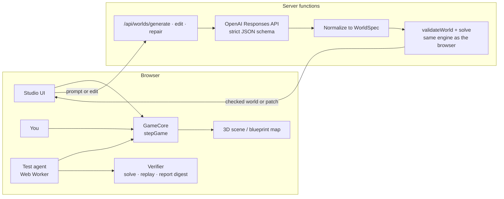

<div align="center">

# Vect

**The AI game studio that plays what it builds.**

Describe a world in plain English. Vect builds it as a playable 3D puzzle, sends in a test agent that plays by the same rules you do, and proves whether it can be finished. When an edit breaks it, Vect finds the exact reason, proposes a small repair that keeps your goal, and verifies the fix with a fresh run.

**[Try it live at usevect.xyz](https://usevect.xyz)** · no login, no key

Built for the Victoria VR AI Builder Hackathon 2026.



</div>

## Contents

- [Why Vect](#why-vect)
- [Try it in 90 seconds](#try-it-in-90-seconds)
- [Features](#features)
- [How it works](#how-it-works)
- [What is AI and what is deterministic](#what-is-ai-and-what-is-deterministic)
- [What a world can contain](#what-a-world-can-contain)
- [Getting started](#getting-started)
- [Configuration](#configuration)
- [Testing and verification](#testing-and-verification)
- [Measured results](#measured-results)
- [Project structure](#project-structure)
- [Tech stack](#tech-stack)
- [Limitations](#limitations)
- [Credits](#credits)

## Why Vect

AI can now turn a sentence into a 3D scene. Making the scene is the easy part. A scene that renders is not a level that works: one key behind the wrong door and every player is stuck, and nobody finds out until someone plays it.

Vect closes that loop. Every door, key, switch and goal in a generated world is wired to a real rules engine. The person playing and the test agent both move through that engine, so a locked door refuses the agent exactly as it refuses you. A world is only marked **Verified** after a fresh run reaches the goal and a replay of that run matches step for step, on that exact revision of the world.

## Try it in 90 seconds

On [usevect.xyz](https://usevect.xyz):

1. **Open example world**, then **Play**. Walk into the Control Room: the door is locked and the move is refused. Collect the Access Key in the Library, open the door, turn on the Portal Switch and reach the Portal Chamber.
2. Press **Test** and watch the agent play the same world. Its report says **Verified**.
3. Press **Edit** and ask: _"Put the access key inside the room it unlocks."_ Preview the patch and apply it. The draft already warns that the goal is unreachable.
4. Press **Test** again. The agent gets stuck and the report says **Failed** with `CIRCULAR_DEPENDENCY`: the key is behind its own door.
5. Press **Auto-fix**. Vect proposes a bounded patch, screens it, runs a fresh agent test and a replay on the new revision, and only then offers **Commit repaired version**.
6. The **Proof** view shows the failed revision, the exact patch and the verified revision side by side. **Download report** and check it yourself (see [Testing and verification](#testing-and-verification)).

Or start with **Open studio** and describe your own world, for example: _"A sunken temple of five chambers around a flooded court. A pressure plate lowers a stone barrier, and a bronze key opens the relic sanctum."_



| The agent fails, with the reason                                      | The repair, verified before it can be committed                  | The proof, before and after                                                |
| --------------------------------------------------------------------- | ---------------------------------------------------------------- | -------------------------------------------------------------------------- |
|  |  |  |

## Features

- **Prompt to playable world.** A sentence becomes rooms, connections, keys, doors, switches, barriers and a goal, rendered as a 3D architectural maquette in three themes (castle, observatory, temple).
- **Real play.** Click rooms and objects, or use WASD, arrow keys and E. Every move goes through the rules engine; the renderer only shows the state the engine returns.
- **Natural-language edits.** Ask for a change, preview the patch as readable operations, then apply it as a new revision. Earlier reports go **Stale** the moment the world changes.
- **Autonomous playtest agent.** Plays the world in a Web Worker through the same `stepGame` rules, with a visible timeline of accepted and refused actions.
- **Dependency check.** A bounded breadth-first solver explores every reachable state. Running out of budget is reported as **Inconclusive**, never as unreachable or verified.
- **Bounded repair.** Up to three repair attempts, each a small patch from a fixed set of operations. Patches that remove the goal, make it trivially true, bypass a required mechanic or hand the player an item are rejected.
- **Proof and reproducibility.** Every report is bound to a world revision hash and a seed, carries a full trace and a SHA-256 digest, and can be re-run from the command line.
- **Honest labels.** Every world shows where it came from: live AI, with the model name, or the bundled example world. If the model is unavailable, the app says so and offers **Retry** and, separately, **Open example world**.
- **Works without 3D.** If WebGL is unavailable, a blueprint map with the same room controls lets you play and test the world.

## How it works



1. **Generate.** The server sends your prompt to the model as data inside a delimited block. The model returns declarative JSON through a strict structured-output schema; nothing it returns is ever run as code. The server normalizes it into a versioned `WorldSpec`, validates every reference and runs the solver before the world reaches you. One corrective retry is allowed, using the real validator message.
2. **Play.** `stepGame(world, state, action)` is the single source of truth. A refused action returns the same state with a reason such as `DOOR_LOCKED`.
3. **Test.** The verifier checks the schema and references, runs the bounded solver, plays the world with the agent, and replays the agent's trace. The report records the world revision hash, the seed, the trace, and state hashes before and after every step.
4. **Repair.** The server proposes a patch (from the model, or from a labelled deterministic rule for recognized failures), applies it to a copy, rejects intent-breaking patches and pre-checks it with the solver. The browser then runs a fresh agent test and a replay on the candidate's own revision. Only that run can mark it **Verified**. The broken revision and its failed report are never changed.

**Trust boundary.** The OpenAI key lives only in server functions and never reaches the browser bundle. Every request body, model output and API response is parsed with zod before use.

## What is AI and what is deterministic

| Part                                        | How it works                                                                                                      |
| ------------------------------------------- | ----------------------------------------------------------------------------------------------------------------- |
| World generation and natural-language edits | **Live AI** (OpenAI), labelled "AI generated" with the model name                                                 |
| Repair proposals                            | **Live AI**, or a **deterministic rule** for recognized failure codes, labelled as such                           |
| Rules engine, solver, agent, replay, report | **Deterministic code.** The solver is a solver and the agent is a rule-based playtest agent, not a language model |
| Example world                               | A **bundled fixture**, labelled "Example world"                                                                   |
| Landing page illustrations                  | AI-generated images, captioned "AI-generated illustration" where they appear                                      |

## What a world can contain

| Element      | Limits and behaviour                                                                                          |
| ------------ | ------------------------------------------------------------------------------------------------------------- |
| Rooms        | 4 to 10 rooms on an integer grid                                                                              |
| Connections  | 3 to 15 undirected connections, optionally gated by a door or portal                                          |
| Entities     | Up to 40: keys, doors, switches, barriers, chests, traps, checkpoints, portals, one goal and decorative props |
| Interactions | Each interactive object works once, when its requirement holds and any consumed item is held                  |
| Gates        | A gated connection unlocks permanently the first time you pass with its requirement met                       |
| Goal         | Reached when you are in the goal room and its condition holds                                                 |
| Prompts      | 10 to 1,000 characters                                                                                        |
| Repairs      | At most 3 attempts, each patch at most 8 operations from the repair-safe set                                  |

## Getting started

Requirements: Node 24 and pnpm 10.33.0.

```sh
git clone https://github.com/Enoch208/vect.git
cd vect
pnpm install --frozen-lockfile
cp .env.example .env
pnpm dev
```

Open http://127.0.0.1:5200. **The example world, play, agent tests and the proof view work without a key.** To enable live generation, edits and AI repairs, set `OPENAI_API_KEY` in `.env` (keep the file private, for example `chmod 600 .env`) and restart the dev server.

### Deploying

The app and its API functions are configured for Vercel (`vercel.json`). Set the variables from `.env.example` in the project's environment before deploying. A static-only `vite preview` does not serve the API routes.

## Configuration

| Variable                 | Default       | Purpose                                                                               |
| ------------------------ | ------------- | ------------------------------------------------------------------------------------- |
| `OPENAI_API_KEY`         | (none)        | Server-side key for live generation, edits and repairs. Never prefix it with `VITE_`. |
| `OPENAI_MODEL`           | `gpt-6.1-sol` | Model ID used by the server                                                           |
| `AI_TIMEOUT_MS`          | `20000`       | Per-request model timeout (1,000 to 60,000)                                           |
| `AI_MAX_CONCURRENT`      | `3`           | Concurrent model calls per server instance                                            |
| `AI_RATE_LIMIT_PER_HOUR` | `8`           | Model calls per IP address per hour, per server instance                              |

API routes: `POST /api/worlds/generate`, `POST /api/worlds/edit`, `POST /api/worlds/repair`, `GET /api/health`. Errors use one JSON envelope with statuses 400, 422, 429, 502, 503 and 504.

## Testing and verification

```sh
pnpm gate                    # typecheck, lint, format check, all unit tests, production build
pnpm test                    # all Vitest projects
pnpm test --project engine   # one project: engine, ai, world, studio, landing, proof
pnpm test:e2e                # Playwright judge path; set E2E_BASE_URL to test a deployment
```

The browser tests play the example world to the goal, run the agent to **Verified**, win again with WebGL disabled, and (when a model is configured) run the full break, fail, repair and prove loop.

**Check a report yourself.** Download a report from the Proof view, then:

```sh
pnpm verify-report path/to/vect-report-<world>-<revision>.json
```

It recomputes the digest, re-hashes the world and compares it with the report's revision, replays the trace through `stepGame`, reruns the agent from the recorded seed, checks that the new run takes exactly the recorded actions, and compares engine versions. It prints `REPRODUCED` or `REJECTED`. The digest is an integrity check (SHA-256 of the canonical report body), not a signature.

## Measured results

Every number below comes from a recorded run. They are individual measurements on one machine, not guarantees.

| What                         | Result                                                                                          | Conditions                                                                                                                                    |
| ---------------------------- | ----------------------------------------------------------------------------------------------- | --------------------------------------------------------------------------------------------------------------------------------------------- |
| Unit and integration tests   | 375 passing                                                                                     | `pnpm gate`, 11 Nov 2026                                                                                                                      |
| Deterministic repair suite   | 26 of 26 broken fixtures went from Failed to Verified, 62 ms total                              | 15 circular dependencies, 6 missing items or flags, 5 disconnected worlds; seed 11; deterministic rules, not a model repair rate; 10 Nov 2026 |
| Frame rate, production build | Median 60 fps; slowest frame 53–55 fps over 30 s per theme                                      | 10-room, 24-entity worlds; Apple M5, Chrome, 1366×768; one 30 s run per theme; 11 Nov 2026                                                    |
| Live model latency           | Generation 10–13 s for a 4-room world, 14–22 s for a 6-room world; edits 3–4 s; repairs 2.5–4 s | Individual end-to-end runs with `gpt-6.1-sol` on 11 Nov 2026, not a benchmark                                                                 |

## Project structure

```
api/                 Vercel functions: worlds/generate, worlds/edit, worlds/repair, health
src/contract/        Shared schemas, codes, limits and versions (the seam every part imports)
src/domain/          GameCore: canonical hashing, expressions, transitions, stepGame, patches
src/verification/    validateWorld, solve (bounded BFS), replay, report and digest
src/agents/          Playtest agent, test runner (Web Worker), deterministic repair rules
src/fixtures/        Example world and the failure and repair fixture suite
src/generation/      Server-only model layer: prompts, schemas, normalizer, editor, repair proposer
src/server/          Server-only helpers: env, OpenAI client, rate limit, error envelope
src/components/      world (3D scene), studio, game, test, proof, landing
src/store/           zustand stores and browser persistence
tests/               Vitest projects per area, plus Playwright end-to-end tests
scripts/             verify-report, screenshots, deploy
```

## Tech stack

TypeScript 5.9 · React 19 · three.js 0.187 with React Three Fiber 9 and Drei 10 · zustand · zod 4 · OpenAI Responses API with structured outputs · Vite 8 · Tailwind CSS 4 · Vitest 5 · Playwright · deployed on Vercel.

## Limitations

- Vect builds **bounded puzzle and exploration worlds**: rooms on a grid, connections, keys, doors, switches, barriers and a goal. It does not generate arbitrary 3D geometry, physics or game scripts.
- **"Verified" means verified within Vect's gameplay rules** for that exact revision and seed. It is not a claim that a world is free of every possible defect.
- The solver has a 100,000-state budget. A world too large to search completely is reported as **Inconclusive**.
- Live features need a configured model. Latency varies by request, and larger worlds take longer to generate.
- Rate and concurrency limits are held in memory per server instance and are not shared across replicas.
- Projects and reports are stored in your browser. Export a world or report before clearing browser data. Generation sends your prompt to OpenAI; edits and repairs also send the current world.

## Credits

Libraries, fonts, AI-generated images and services are listed with their sources and terms in [THIRD_PARTY.md](THIRD_PARTY.md). Scene geometry and technical drawings are generated in code. The screenshots in this README are frames from a recording of the running app.
